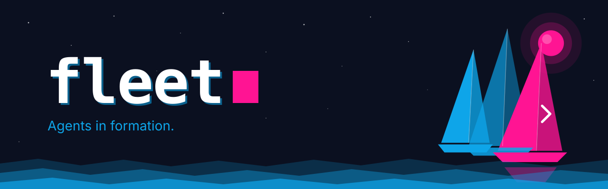
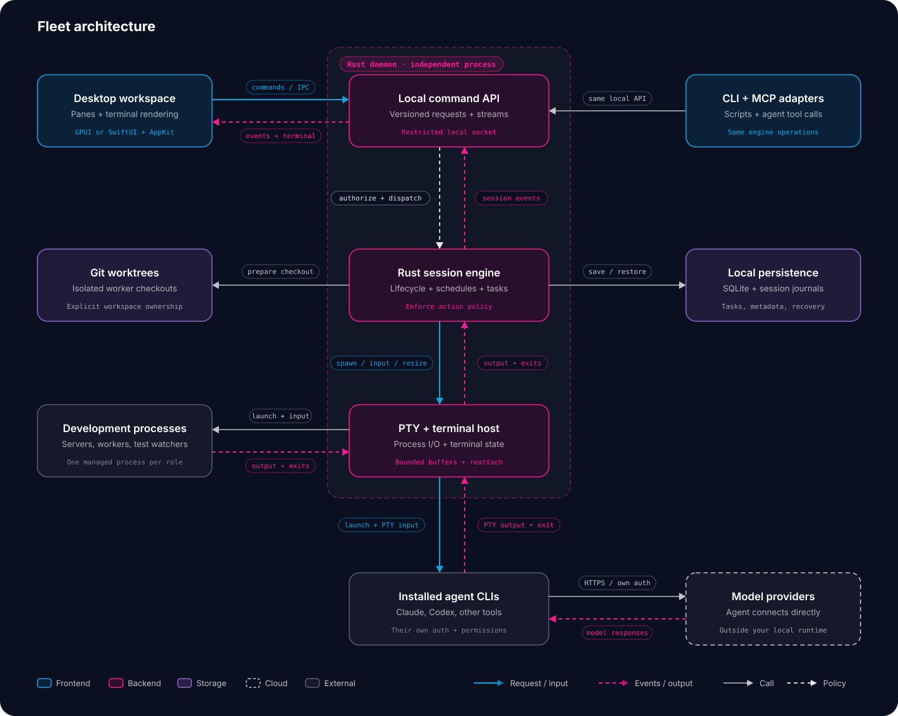
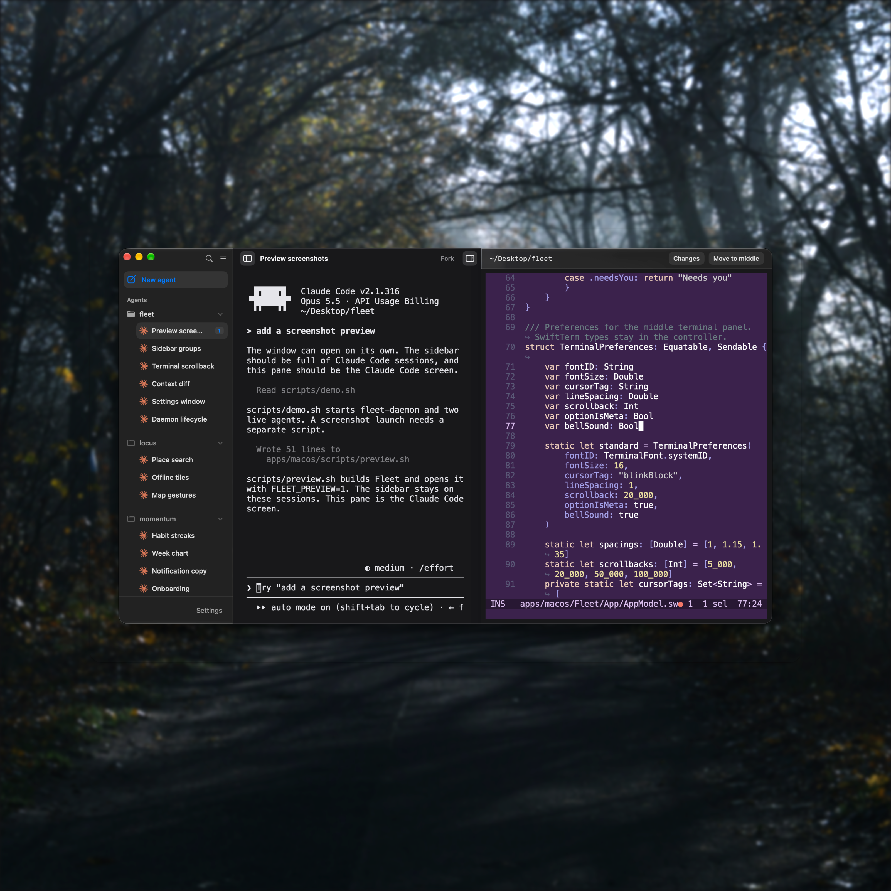

Agentic Development Environment for running and coordinating coding agents, backed by a Rust engine.

## Architecture



The Rust daemon owns agent processes and terminal sessions independently of the desktop UI. Closing the UI detaches the client; running agents continue until they exit or the daemon stops.

- **Desktop frontend:** a SwiftUI macOS prototype in `apps/macos` with AppKit and SwiftTerm for terminal rendering. GPUI remains an option for a future cross-platform frontend.
- **Local API:** a versioned Unix-socket API with commands, events, and bounded terminal streams for the planned UI, CLI, and MCP adapters.
- **Session engine:** agent lifecycle, scheduling, task coordination, action policy, and worktree ownership.
- **PTY and terminal host:** process input/output, resizing, bounded buffers, and session reattachment.
- **Persistence:** SQLite and session journals for task state, metadata, history, and recovery.
- **Agent tools:** installed CLI agents use their own credentials and permissions, connecting directly to their model providers.

This diagram describes the proposed design. The Rust workspace provides an engine with PTY-backed sessions and a standalone daemon serving a Unix local API. A SwiftUI macOS prototype now renders two live terminal panes from that API. Persistence, ordered replay, and the Windows local transport have not been implemented yet.

The first milestone is one project with two live agent sessions, reliable terminal input and resizing, and reconnecting the UI without restarting agents.

## Rust workspace

The workspace uses Rust edition 2024 and Cargo resolver 3:

- `crates/engine` (`fleet-engine`): engine lifecycle and PTY-backed sessions, independent of clients, transport, and OS signals.
- `crates/protocol` (`fleet-protocol`): shared protocol version, serializable daemon states, local API messages, error codes, and size limits.
- `crates/daemon` (`fleet-daemon`): runtime, socket configuration, JSON logging, signal handling, and the Unix local API server. It depends on both libraries; the libraries do not depend on each other.

The daemon runs in the foreground without a UI. It starts the engine, binds a user-owned Unix socket, reports readiness, and serves versioned requests from local clients. Clients can create, list, inspect, and stop sessions; attach and detach; stream ordered output and status; send input; and resize. Nothing is persisted across daemon restarts. On Windows the daemon currently starts without a local API.

## Local API

The local API is Unix-only in this pass. The default socket is `$XDG_RUNTIME_DIR/fleet/daemon.sock`, or `<system-temp>/fleet-<uid>/daemon.sock` when `XDG_RUNTIME_DIR` is unset (`$TMPDIR` is used when defined). Precedence is `--socket <path>` / `--socket=<path>`, then `FLEET_SOCKET`, then the default. Relative paths resolve against the working directory; socket paths are limited to 100 bytes. The daemon creates missing parents, keeps the default parent at `0700`, refuses symlinked or foreign-owned parents (including `/tmp` itself), and restricts the socket to `0600`. Use a per-user parent such as `$HOME/.fleet`. Accepted peers must have the daemon user's UID.

Frames are a 4-byte big-endian length followed by UTF-8 JSON; the limit is 4 MiB per frame. Binary terminal data is base64. The first frame must be a `hello` with protocol version 1 within five seconds. Requests then carry a client-chosen `request_id` and a command: `create_session`, `list_sessions`, `inspect_session`, `stop_session`, `input`, `resize`, `attach_session`, or `detach_session`.

An attach response includes session metadata and a retained output snapshot. Subsequent `output` events carry monotonic sequence numbers, and `status` events report state changes. The daemon serves at most 32 clients, bounds each outbound queue, and disconnects clients that fall behind (sending `slow_client` when the queue has room); reattach to resynchronize. Input is limited to 1 MiB per request. On shutdown, attached clients receive `daemon_stopping`.

Start a daemon on an explicit socket and try the API:

```sh
cargo run -p fleet-daemon --locked -- --socket "$HOME/.fleet/daemon.sock"
```

```python
import json, os, socket, struct

sock = socket.socket(socket.AF_UNIX)
sock.connect(os.path.expanduser("~/.fleet/daemon.sock"))

def send(message):
    payload = json.dumps(message).encode()
    sock.sendall(struct.pack(">I", len(payload)) + payload)

def receive():
    header = b""
    while len(header) < 4:
        chunk = sock.recv(4 - len(header))
        if not chunk:
            raise EOFError("daemon closed the connection")
        header += chunk
    (size,) = struct.unpack(">I", header)
    payload = b""
    while len(payload) < size:
        chunk = sock.recv(size - len(payload))
        if not chunk:
            raise EOFError("daemon closed the connection")
        payload += chunk
    return json.loads(payload)

send({"type": "hello", "protocol_version": 1, "client": "readme"})
print(receive())
send({"type": "request", "request_id": 1, "command": {"command": "list_sessions"}})
print(receive())
```

## macOS prototype



A SwiftUI frontend lives in `apps/macos`. It connects to the daemon, shows one project with two live terminal panes, and reads git status for a context panel. Requirements, shortcuts, limitations, and recorded verification are in [`apps/macos/README.md`](apps/macos/README.md). The frontend decision is recorded in [`docs/decisions/0001-MACOS-FRONTEND.md`](docs/decisions/0001-MACOS-FRONTEND.md).

```sh
apps/macos/scripts/build.sh
apps/macos/scripts/demo.sh
```

`demo.sh` builds the app, starts a daemon on `~/.fleet/daemon.sock` if needed, and opens Fleet with two agent sessions. The app needs macOS 14+ and Xcode 16+; SwiftTerm 1.99.1 is resolved by Swift Package Manager.

## Development scripts

Root-level scripts cover the common development flows:

```sh
scripts/dev.sh      # build and launch Fleet
scripts/build.sh    # build the daemon and app
scripts/install.sh  # replace older installs with a release build from this checkout
scripts/demo.sh     # two live agent panes
scripts/preview.sh  # UI-only window for screenshots
scripts/test.sh     # Rust workspace and FleetKit tests
scripts/verify.sh   # formatting, Clippy, tests, smoke checks, app build
scripts/clean.sh    # remove build artifacts
scripts/release.sh  # release app zip and dmg; optional Developer ID signing
```

See [`scripts/README.md`](scripts/README.md) for details and environment
variables. The macOS release procedure is [`docs/RELEASE.md`](docs/RELEASE.md).

## Build and run the daemon

Install a Rust toolchain with Cargo, rustfmt, and Clippy. Rust/Cargo 1.98.0 from Homebrew was used to validate this workspace on Apple Silicon macOS. Edition 2024 requires Rust 1.85 or newer; a minimum supported version for all dependencies has not been established. Rustup is optional; Homebrew's toolchain works directly.

```sh
cargo build --workspace --locked
cargo run -p fleet-daemon --locked
```

Logs are newline-delimited JSON on stderr; stdout is unused. The default log level is INFO. Set `RUST_LOG` to change it, for example:

```sh
RUST_LOG=debug cargo run -p fleet-daemon --locked
RUST_LOG=fleet_daemon=info cargo run -p fleet-daemon --locked
```

An invalid `RUST_LOG` exits with status 1 and a JSON error. Filtering out INFO hides readiness and normal lifecycle events. Startup failures and shutdown errors also exit with status 1.

On Unix, SIGINT (Ctrl-C) and SIGTERM handlers are registered before the `ready` event, which includes the version, protocol version, PID, engine state, and socket path. On Windows, the daemon registers a Ctrl-C handler and reports `api="unavailable"`. After a signal it logs `shutdown_requested`, notifies attached clients, awaits idempotent engine shutdown with a five-second deadline, removes the socket, logs `stopped`, and exits with status 0. Engine shutdown terminates every session with bounded waits. Stopping the foreground daemon stops the engine and its child processes; running it does not install a system service.

To run the release binary directly:

```sh
cargo build -p fleet-daemon --release --locked
./target/release/fleet-daemon
```

## Test and check

```sh
cargo test --workspace --locked
cargo fmt --all -- --check
cargo clippy --workspace --all-targets --locked -- -D warnings
cargo metadata --no-deps --format-version 1 --locked
```

Tests cover engine shutdown, PTY session lifecycle and I/O, protocol serialization, the local API, and Unix daemon subprocess behavior: operation without a UI, clean SIGINT/SIGTERM exit, JSON logs on stderr, and invalid logging configuration. API tests exercise handshake and version checks, owner-only socket permissions, malformed and oversized frames, create/list/inspect/stop, ordered output/input/status, snapshot replay, resize, multi-client attachment, live/stale sockets, and shutdown notification. Session tests use real PTYs with `/bin/sh` and `stty`, so they do not require agent CLIs. Process tests allow up to 30 seconds for startup and shutdown to tolerate loaded CI hosts and terminate/reap children on failure. The engine's own shutdown deadline remains five seconds. Unix subprocess and local API tests are platform-gated; Windows Ctrl-C behavior, named pipes, and process-tree containment have not been validated here.

## License

Fleet is released under the [MIT License](LICENSE).

