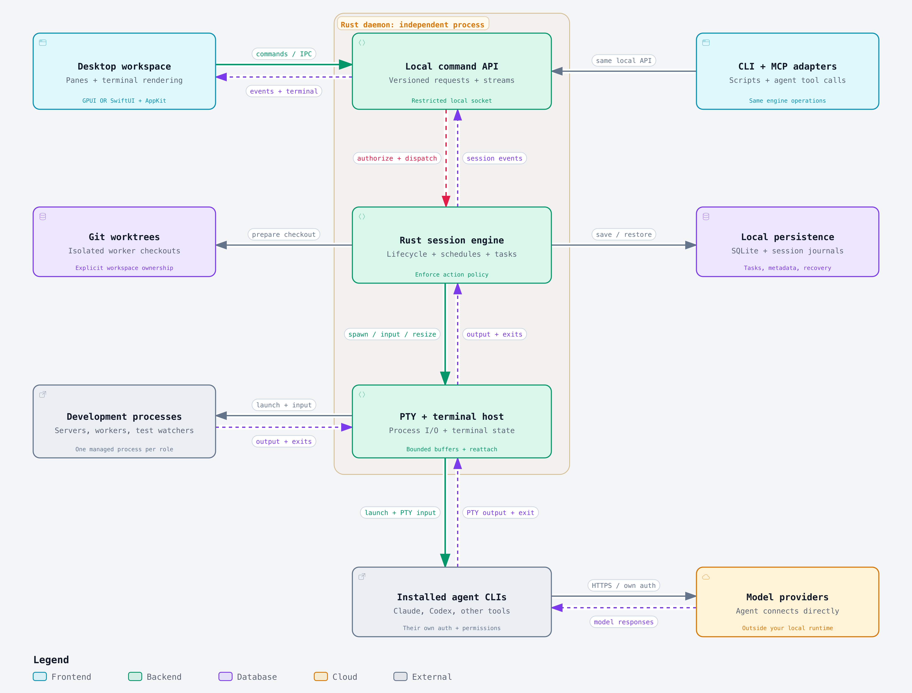

# Director

A proposed desktop workspace for running and coordinating coding agents, backed by a Rust engine.

## Architecture



The Rust daemon owns agent processes and terminal sessions independently of the desktop UI. Closing the UI detaches the client; running agents continue until they exit or the daemon stops.

- **Desktop frontend:** GPUI for a Rust interface across desktop platforms, or SwiftUI with AppKit for a Mac-focused app.
- **Local API:** versioned commands, events, and terminal streams shared by the UI, CLI, and MCP adapters.
- **Session engine:** agent lifecycle, scheduling, task coordination, action policy, and worktree ownership.
- **PTY and terminal host:** process input/output, resizing, bounded buffers, and session reattachment.
- **Persistence:** SQLite and session journals for task state, metadata, history, and recovery.
- **Agent tools:** installed CLI agents use their own credentials and permissions, connecting directly to their model providers.

This diagram describes the proposed design. The Rust workspace currently provides an empty engine and a standalone daemon; agent sessions and the desktop frontend have not been implemented yet.

The first milestone is one project with two live agent sessions, reliable terminal input and resizing, and reconnecting the UI without restarting agents.

## Rust workspace

The workspace uses Rust edition 2024 and Cargo resolver 3:

- `crates/engine` (`director-engine`): engine lifecycle, independent of clients, transport, and OS signals.
- `crates/protocol` (`director-protocol`): shared protocol version and serializable daemon states used in lifecycle logs.
- `crates/daemon` (`director-daemon`): runtime, configuration, JSON logging, and signal handling. It depends on both libraries; the libraries do not depend on each other.

The daemon runs in the foreground without a UI. It starts an empty engine, reports readiness, and waits for a shutdown signal. This foundation does not yet spawn agents, expose a local API, or persist state.

## Build and run

Install a Rust toolchain with Cargo, rustfmt, and Clippy. Rust/Cargo 1.98.0 from Homebrew was used to validate this workspace on Apple Silicon macOS. Edition 2024 requires Rust 1.85 or newer; a minimum supported version for all dependencies has not been established. Rustup is optional; Homebrew's toolchain works directly.

```sh
cargo build --workspace --locked
cargo run -p director-daemon --locked
```

Logs are newline-delimited JSON on stderr; stdout is unused. The default log level is INFO. Set `RUST_LOG` to change it, for example:

```sh
RUST_LOG=debug cargo run -p director-daemon --locked
RUST_LOG=director_daemon=info cargo run -p director-daemon --locked
```

An invalid `RUST_LOG` exits with status 1 and a JSON error. Filtering out INFO hides readiness and normal lifecycle events. Startup failures and shutdown errors also exit with status 1.

On Unix, SIGINT (Ctrl-C) and SIGTERM handlers are registered before the `ready` event, which includes the version, protocol version, PID, and engine state. On Windows, the daemon registers a Ctrl-C handler. After a signal it logs `shutdown_requested`, awaits idempotent engine shutdown with a five-second deadline, logs `stopped`, and exits with status 0. The empty engine owns no worker processes or tasks. Stopping the foreground daemon stops the engine; running it does not install a system service.

To run the release binary directly:

```sh
cargo build -p director-daemon --release --locked
./target/release/director-daemon
```

## Test and check

```sh
cargo test --workspace --locked
cargo fmt --all -- --check
cargo clippy --workspace --all-targets --locked -- -D warnings
cargo metadata --no-deps --format-version 1 --locked
```

Tests cover engine shutdown, protocol state serialization, and Unix daemon subprocess behavior: operation without a UI, clean SIGINT/SIGTERM exit, JSON logs on stderr, and invalid logging configuration. Process tests allow up to 30 seconds for startup and shutdown to tolerate loaded CI hosts and terminate/reap children on failure. The engine's own shutdown deadline remains five seconds. Unix subprocess signal tests are platform-gated; Windows Ctrl-C behavior has not been validated here.
